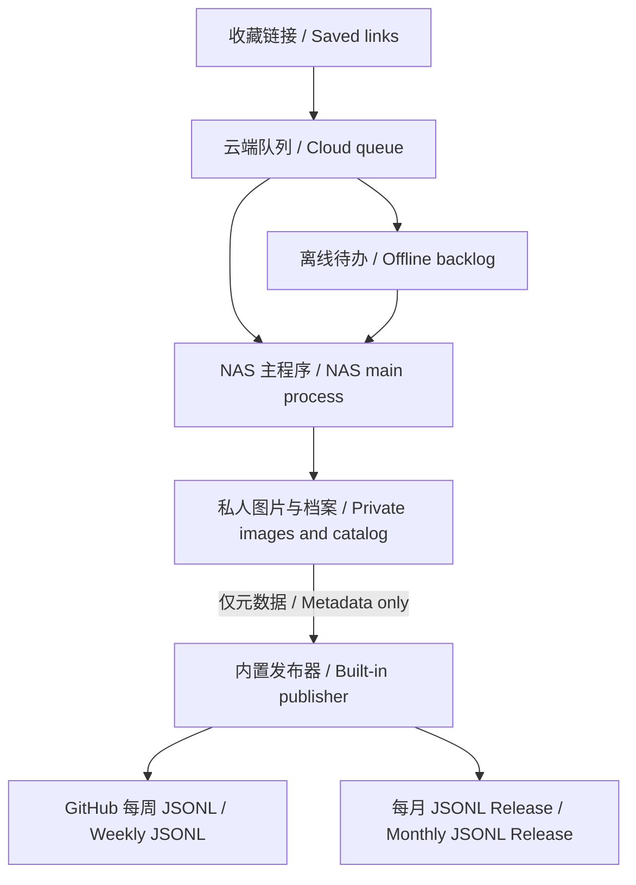

# Social Image Archive · 图片收藏与 JSONL 分享

## 中文

这是一个**个人爱好与学习项目**：把自己收藏的图片整理到私人图库，再把来源信息整理成容易下载的 JSONL 目录。

**公开分享的只有来源链接和元数据，不分发图片本身。** 图片原文件和缩略图保留在本地，不会提交到 GitHub，也不会打包进 Release。图片是否还能访问，取决于原始来源网站。

### 它是怎么工作的？

1. 收藏端提交图片链接、作者、标签和原帖时间。
2. 云端队列暂存任务，NAS 的消费程序下载并整理到私人图库。NAS 离线时，云端待办帮助恢复遗漏任务。
3. 同一个主程序还运行一个轻量发布调度器，读取本地档案的元数据，生成 JSONL。
4. 发布器从 GitHub Token 获取账号，按配置的仓库名自动创建公开仓库。每天先 `git fetch`、`git pull`，再提交和推送元数据。
5. 每周使用一个新 JSONL；每月创建一个仅附带上个月 JSONL 的 Release。



### 发布节奏

- **每天**：默认上海时间 `03:15`，提交当天快照。没有新收藏时也更新发布日期。
- **每周**：根据入库时间 `archivedAt` 划分 ISO 周，文件为 `weeks/YYYY-Www.jsonl`；`publishedAt` 仍记录原帖时间。
- **每月**：1 日发布上个月的 `YYYY-MM.jsonl`，Tag 为 `archive-YYYY-MM`。
- **重启或失败**：主程序启动后检查遗漏任务，失败后约 30 分钟重试。调度随主程序运行，不使用系统 cron 或 systemd timer。

发布器会保留你在 GitHub 上编辑的 README 和其他非托管文件。发生 Git 合并冲突时会停下报告，不强制覆盖。已发布的月度 Release 保留当时的快照。

### 首次部署：从 example 创建本地配置

仓库只跟踪 example 示例；实际使用的配置保留在本机，并由 .gitignore 忽略。**以下复制命令仅用于全新部署；已有实例保留自己的本地配置，不要覆盖。**

```bash
cp .env.example .env
cp wrangler.example.jsonc wrangler.jsonc
cp compose.example.yaml compose.yaml
cp publisher.config.example.json publisher.config.json
cp publisher.env.example publisher.env
mkdir -p data-docker publisher-state .secrets .wrangler-auth
chmod 700 publisher-state .secrets .wrangler-auth
chmod 600 .env publisher.env publisher.config.json wrangler.jsonc
bun install --frozen-lockfile
```

1. 在 `wrangler.jsonc` 中填写自己的 Cloudflare 账号和 D1 数据库 ID，并确认 Worker、两条队列和数据库名称。示例中的全零 ID 必须替换；`IMAGES`、`DEADLINES`、`DB` 是代码使用的绑定名。
2. 按 [归档说明](docs/ARCHIVE.md#云端资源安装与部署) 创建队列和 D1、应用迁移并部署 Worker。将部署得到的 URL、账号 ID 和主队列 ID 填到 `.env`。
3. 选择消费认证方式：在 `.env` 填 `CLOUDFLARE_API_TOKEN`，或者将 `WRANGLER_AUTH_DIR` 指向自己已登录的 Wrangler 配置目录。使用 API Token 时可以保留默认的空 `.wrangler-auth/` 目录。
4. 要发布 GitHub JSONL，将 classic PAT（`public_repo`）写入 `.secrets/github-token` 并设权限 `600`；在 `publisher.config.json` 设置仓库名。owner 由 Token 自动识别。暂不发布可设 `enabled: false`。
5. 核对 UID/GID、目录和可选代理后，运行 `docker compose config --quiet` 检查配置，再按自己的运维流程启动。Worker 接口当前不含接入鉴权，使用者需自行配置部署地址和访问范围。

实际配置、凭据、图片、数据库和发布状态均被 Git 忽略。配置项目的中英文完整清单见本文末尾。

发布器每分钟读取 `publisher.config.json`；修改仓库名、时区、时间或开关会在下一次检查生效。日常命令：`bun run share:preview /tmp/new-preview-directory` 预览、`bun run share:status` 查看状态。更多细节见 [发布说明](docs/PUBLISHING.md)、[归档说明](docs/ARCHIVE.md) 和 [MCP 说明](docs/MCP.md)。

## English

This is a **personal hobby and learning project**. It organizes saved images in a private gallery and shares an easy-to-download JSONL catalog of their sources.

**The public repository distributes source links and metadata only, never the images themselves.** Original images and thumbnails stay local. They are neither committed to GitHub nor bundled into Releases. Source websites control whether their links remain available.

### How it works

1. A collection client submits an image URL, author, tags and the original post time.
2. A cloud queue holds the task. The NAS consumer downloads the image into a private gallery. A cloud backlog helps recover work after the NAS has been offline.
3. A lightweight publisher runs inside the same main process and builds JSONL from the local metadata.
4. The publisher identifies the account from its GitHub token and creates the configured public repository when needed. It runs `git fetch` and `git pull` before committing and pushing metadata.
5. Weekly JSONL files and monthly JSONL-only Releases provide convenient snapshots. The diagram above shows the complete flow.

### Schedule and configuration

- **Daily:** one snapshot at `03:15` in `Asia/Shanghai` by default, including a publication-date update on quiet days.
- **Weekly:** `weeks/YYYY-Www.jsonl`, grouped by the local archive time (`archivedAt`). The original post time remains in `publishedAt`.
- **Monthly:** on the first day, publish the previous month's `YYYY-MM.jsonl` under `archive-YYYY-MM`.
- **Recovery:** check on main-process startup and retry failures after about 30 minutes. Scheduling belongs to the application, with no system cron or systemd timer.

### First-time setup from examples

Git tracks the example files. Actual deployment configuration stays local and is ignored by Git. **Run the copy commands in the Chinese section only for a new deployment. Preserve the local configuration of an existing installation.**

1. Copy the example files, create the data/state/auth directories and install dependencies with `bun install --frozen-lockfile`.
2. Set your Cloudflare account ID and D1 database ID in `wrangler.jsonc`; replace all-zero placeholders and check resource names. Keep the code bindings `IMAGES`, `DEADLINES` and `DB`.
3. Create both queues and the D1 database, apply migrations and deploy the Worker. Put the resulting Worker URL, account ID and primary queue ID in `.env`. See [archive setup](docs/ARCHIVE.md#云端资源安装与部署).
4. Supply `CLOUDFLARE_API_TOKEN`, or set `WRANGLER_AUTH_DIR` to your own logged-in Wrangler configuration directory. When using an API token, the default empty `.wrangler-auth/` directory is sufficient for the Compose mount.
5. For JSONL publication, save a classic PAT with `public_repo` in `.secrets/github-token` with mode `600`. Set the repository name in `publisher.config.json`; the owner is discovered from the token. Set `enabled` to `false` to disable publishing.
6. Check filesystem ownership, optional proxy settings and `docker compose config --quiet` before starting services through your own operations workflow. Worker endpoints currently have no built-in ingress authentication; configure deployment addresses and access scope for your environment.

Local configuration, credentials, images, databases and runtime state are excluded from Git. The publisher reloads its JSON configuration every minute. README edits and other unmanaged files are preserved; conflicts stop publication instead of forcing an overwrite. Monthly Releases remain historical snapshots.

Use `bun run share:preview /tmp/new-preview-directory` to preview and `bun run share:status` to inspect the last result. See [publishing details](docs/PUBLISHING.md), [archive operations](docs/ARCHIVE.md) and [MCP](docs/MCP.md).

## 配置清单 / Configuration checklist

### 文件对应关系 / Example files and local files

| 脱敏示例 / Example | 本地文件 / Local file | 用途 / Purpose |
| --- | --- | --- |
| `wrangler.example.jsonc` | `wrangler.jsonc` | Worker、Queues、D1 部署 / Cloudflare deployment |
| `compose.example.yaml` | `compose.yaml` | 本地服务与挂载 / Local service and mounts |
| `.env.example` | `.env` | Worker 入口、消费凭据、NAS 设置 / Endpoint, consumer credentials and host settings |
| `publisher.config.example.json` | `publisher.config.json` | 发布开关、仓库、时区和时间 / Publisher settings |
| `publisher.env.example` | `publisher.env` | 可选宿主机 CLI 路径与代理 / Optional host CLI paths and proxy |
| 无 / None | `.secrets/github-token` | 你自己的 GitHub Token / Your own GitHub token |

### 必须配置 / Required deployment values

| 配置项 / Setting | 文件 / File | 说明 / Description |
| --- | --- | --- |
| `account_id` | `wrangler.jsonc` | Cloudflare 账号 ID，替换全零值 / Replace with your account ID |
| `d1_databases[].database_id` | `wrangler.jsonc` | 创建 D1 后返回的数据库 ID / ID returned when creating D1 |
| `name`、`queues.*[].queue`、`database_name` | `wrangler.jsonc` | 使用者资源名称，绑定名需与代码一致 / Resource names; keep code binding names consistent |
| `QUEUE_WORKER_URL` | `.env` | 自己部署后的 Worker HTTPS URL / Your deployed Worker URL |
| `CF_ACCOUNT_ID` | `.env` | 与部署账号一致 / Same Cloudflare account |
| `CF_QUEUE_ID` | `.env` | 主队列 ID，而非队列名称 / Primary queue ID, not its name |
| `CLOUDFLARE_API_TOKEN` 或 `WRANGLER_AUTH_DIR` | `.env` | 队列 API Token 或有效 OAuth 目录，二选一 / Queue API token or valid OAuth directory |

### 发布配置 / Publication settings

| 配置项 / Setting | 文件 / File | 说明 / Description |
| --- | --- | --- |
| `enabled` | `publisher.config.json` | 默认 true；false 暂停发布 / false pauses publication |
| `repositoryName` | `publisher.config.json` | 分享仓库名；owner 自动读取，公开仓库不存在时创建 / Repository name; owner is automatic |
| `branch` | `publisher.config.json` | 默认 main / Default main |
| `timezone`、`dailyTime` | `publisher.config.json` | 默认 Asia/Shanghai、03:15；控制日/周/月边界 / Schedule and period boundaries |
| GitHub Token | `.secrets/github-token` | 开启发布时需要，classic PAT 的 public_repo，文件权限 600 / Required for publication; mode 600 |

### 按环境调整 / Environment-dependent and optional settings

| 配置项 / Setting | 文件 / File | 说明 / Description |
| --- | --- | --- |
| `routes` | `wrangler.jsonc` | 可选自定义域名；示例为空 / Optional custom domains; empty by default |
| `LOCAL_UID`、`LOCAL_GID` | `.env` | 必须匹配数据、状态和 OAuth 目录的实际所有者 / Match directory ownership |
| `WRANGLER_AUTH_DIR` | `.env` | OAuth 时为实际配置目录；API Token 时默认空目录 / Real OAuth directory or empty mount for API-token use |
| `PORT`、`POLL_SECONDS` | `.env` | 图库端口 19280、轮询间隔 60 秒 / Gallery port and polling interval |
| `ARCHIVE_HTTP_PROXY`、`ARCHIVE_NO_PROXY` | `.env` | 可选容器出站代理与直连名单；默认无代理 / Optional container proxy and bypass hosts |
| `MCP_MAX_PICK`、`MCP_TRUST_PROXY` | `.env` | 默认 3、false / MCP result limit and trusted proxy headers |
| `ARCHIVE_DIR`、`HOST` | `.env` 或宿主机环境 / host environment | 宿主机开发目录和监听地址；Compose 固定使用 /app/data 与 0.0.0.0 / Host development only; Compose uses container paths |
| `SHARE_CONFIG_FILE`、`SHARE_TOKEN_FILE`、`SHARE_STATE_DIR` | `publisher.env` | 可选宿主机 CLI 路径覆盖；Compose 使用内部路径 / Optional host CLI path overrides |
| `HTTP_PROXY`、`HTTPS_PROXY`、`NO_PROXY` | `publisher.env` | 可选宿主机 CLI 代理；默认直连 / Optional host CLI proxy |

## 相关项目 / Related projects

- [JSONL 数据集 / JSONL dataset](https://github.com/WsureDev/x-image-archive) — 每周元数据与月度 Release，仅分享来源链接，不分发图片文件。 / Weekly metadata and monthly Releases, with source links only.
