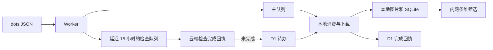

# 社交图片队列与本地建档

dots 提交图片链接、标签、作者和发布时间。Cloudflare Workers 接收，原生 Queues 排队；本地 Bun 消费程序下载图片，SQLite 保存档案，并提供内网筛选页面。本地通过 Docker Compose 常驻运行。

## 首次部署配置

这里的域名、IP 和路径均为示例。先按主 README 的配置清单复制 example 文件并填入自己的值，生产配置不会随源码分发。

- 云端入口来自你自己的 Worker 部署结果；示例为 `https://your-worker.example.com`。
- 图库示例地址为 `http://192.0.2.10:19280/`；`192.0.2.10` 是文档用地址，请替换为实际 NAS 主机名或 IP。
- `wrangler.example.jsonc` → `wrangler.jsonc`，填写账号、D1 数据库 ID；可按需配置自定义域名。
- `compose.example.yaml` → `compose.yaml`，读取你创建的 `.env`；图片、SQLite 和状态位于项目自己的持久目录。
- API Token 和 Wrangler OAuth 两种队列认证方式任选其一。API Token 填在 `.env`；OAuth 方式则将 `WRANGLER_AUTH_DIR` 指向已登录的宿主目录，允许 OAuth 自动刷新。
- 可选代理通过 `ARCHIVE_HTTP_PROXY` 设置；默认不指定代理。
- 运行时为 Bun 1.4.4。Dockerfile 使用已安装的 `node_modules`，构建前运行 `bun install --frozen-lockfile`。
- 主程序同时运行图库、消费和 JSONL 调度；容器异常退出时按 `restart: unless-stopped` 恢复，不另设系统定时器。

部署命令示例：

```bash
bun install --frozen-lockfile
docker compose config --quiet
docker compose up -d --build --wait
docker compose ps
docker compose logs -f --tail=100
```

这些命令只供使用者在自己的环境中操作，不会由下载源码自动执行。维护现有实例时遵守其运维审批流程。停止消费后再备份整个数据目录；在线备份 SQLite 应使用其备份机制。

## 离线数天的兜底



倒计时在入队时设置，由 Cloudflare 延迟队列执行，不依赖本地机器在线，也不需要额外的定时扫描凭据。18 小时是最早检查时间，实际执行会有队列调度延迟。

- 每条消息写入两条队列，检查队列延迟 18 小时。
- 图片落盘、SQLite 建档后，本地登记完成回执，再确认主队列消息。
- 到时尚无回执，云端将完整元数据保存到 D1；待办不会自动过期。本地恢复后，主队列和 D1 交替消费。
- 完成回执和已完成的 D1 待办保留至少 7 天，云端每天限量清理；待办和死信不随之删除。
- 下载失败的 D1 任务指数退避，8 次失败后进入 `dead`，支持查看和重新入队。
- 这是至少一次处理：跨队列发送、网络重试、18 小时边界都可能重复。本地用“平台 + 完整图片 URL”生成稳定 ID，并用内容 SHA-256 复用图片文件。相同链接的再次提交保留首次档案。
- 兜底保存的是链接及元数据；原图链接失效后，无法从 D1 恢复图片。Cloudflare 的队列和 D1 同时长时间故障，也可能丢消息。

## 云端资源安装与部署

使用 Bun。源码、运行和依赖安装均不依赖 Python。

```bash
# First copy wrangler.example.jsonc and set your account_id.
bun install --frozen-lockfile
bunx wrangler whoami
# 登录失效时，交互执行：
bunx wrangler login

bunx wrangler queues create social-images
bunx wrangler queues consumer http add social-images
bunx wrangler queues create social-image-deadlines
bunx wrangler d1 create social-image-queue
```

把 `d1 create` 返回的 `database_id` 填入 `wrangler.jsonc` 对应绑定，然后执行：

```bash
bun run types
bun run check
bun test
bunx wrangler d1 migrations apply social-image-queue --remote
bun run deploy
bunx wrangler queues info social-images
```

保留 `queues info` 返回的主队列 ID。检查队列由部署自动绑定 Worker 消费；主队列使用 HTTP Pull，本地主动向外连接，无需开放入站端口或配置 Tunnel。

本地消费默认复用 Wrangler 登录。如需独立 API Token，在 [Cloudflare API Tokens](https://dash.cloudflare.com/profile/api-tokens) 创建 `Account / Queues / Edit` 权限，并填入 `.env` 的 `CLOUDFLARE_API_TOKEN`；环境变量优先于 Wrangler 登录。这是上游 API 凭据，不是内网页面的访问口令。

## dots 入队约定

`POST https://your-worker.example.com/v1/images`，每张图片提交一次：

```json
{
  "platform": "example-social",
  "postId": "post-123",
  "postUrl": "https://social.example/posts/123",
  "imageUrl": "https://cdn.example/image.jpg",
  "tags": ["风景", "夜景"],
  "author": { "id": "user-456", "name": "作者名称" },
  "publishedAt": "2026-10-30T20:30:00+08:00",
  "referer": "https://social.example/"
}
```

成功返回 HTTP 202：`{"id":"<sha256>","deadlineHours":18}`。`tags` 可省略，默认空数组；`postId`、`postUrl`、`referer` 可省略。时间必须含时区。生产者遇到非 2xx 应重试，不需要知道本地是否在线。

下载支持 JPEG、PNG、WebP、GIF、AVIF，每张上限 30 MiB、超时 60 秒。支持 Referer；需要登录 Cookie 的图片暂未接入。

## MCP 挑图

地址：`http://192.0.2.10:19280/mcp`（Streamable HTTP）。提供 `list_image_facets`、`pick_images` 两个只读工具。获得 `pick_images` 返回的 `items[].originalUrl` 后，直接使用下载工具或 HTTP 客户端 GET 下载原图即可。

通过客户端 Header `X-Archive-Max-Pick: 3` 设置单次上限；不传 `count` 时按上限挑图，超量自动截断，返回 `maxPick`。原图下载 URL 根据本次请求 Host 生成，由调用方直接 HTTP 下载；工具只返回元数据和 URL。

完整客户端配置、工具参数和游标示例见 [MCP 使用说明](MCP.md)。

## 导出 JSONL

图库页面右上角点击“导出 JSONL”，下载数据库中全部图片的来源元数据；不受当前筛选、分页或浏览快照限制。也可直接访问 `GET /api/export.jsonl`。

每行是一条 JSON，包含 `id`、来源图片直链 `imageUrl`、`tags`、`author`、`platform`、`publishedAt`、`archivedAt`，以及存在时的 `postId`、`postUrl`。导出采用字段白名单，不导出本地文件名、存储路径、图库原图/缩略图地址、服务 IP 或 Host 配置。文件仅包含元数据，不包含图片二进制。

服务按开始导出时已有记录的范围分批输出，新增入库记录可在下次导出获取。原始图片、SQLite 和消费服务保持运行。

## 图库查询与连续浏览

页面采用 [Tabler](https://tabler.io/)（1.7.3，MIT）的图库、表单和分页样式，本地打包并裁剪未使用样式，不加载 Tabler 的 JavaScript，也不依赖外部 CDN。

- 搜索作者、标签或平台；按作者、精确标签、平台和发布时间组合筛选，提供候选项和一键清空。
- 上下两处分页，支持上一页、下一页、页码按钮、指定页跳转和每页 24 / 48 / 96 张，显示结果总数和当前范围。
- 查询与页码保存在 URL，支持刷新、浏览器前进后退。浏览期间固定本次收藏范围；点击“刷新收藏”获取新增图片。
- “随机看看”会生成新的随机顺序；普通翻页保持同一随机种子，不会逐页重新洗牌。
- 列表只加载按需生成的 480 像素 WebP 缩略图，缓存位于 `data-docker/thumbnails/`；原图保持不变，缩略图生成并发限制为 2。

大图使用 [PhotoSwipe](https://photoswipe.com/) 核心版（5.4.4，MIT），按需加载：只保留前后切换、计数和关闭，没有缩略图导航、缩放工具栏或开关动画。内部复用三个图片槽位，预加载相邻图片；连续浏览可跨越列表页边界。左右方向键 / 导航按钮切图，Esc 关闭，手机支持滑动。卡片上的“原图”仍可单独打开。

Docker 构建时执行 `bun run build:gallery`，前端源码位于 `src/gallery/`；模板样式裁剪脚本位于 `scripts/build-gallery.ts`。宿主机开发运行 `bun run dev:local` 或 `bun start` 时也会先构建图库。

## 低质量图片清理

图库页面支持按当前页面批量清理：勾选图片，点击“标记选中”；确认红色标记无误后，点击“确认删除 N 张”，再次确认才会永久删除数据库记录、标签、原图和缩略图。日期选择器会显示数据库中原帖发布时间的有效范围，并限制可选日期。删除接口只接受图片 ID，不接受路径或文件名。

## 本地消费与筛选

正式运行使用上述 Docker Compose。以下命令仅用于宿主机开发，不要与容器同时监听同一端口，也不要覆盖本机已有 `.env`。

```bash
# 首次开发配置时执行：
cp .env.example .env
# 填 QUEUE_WORKER_URL、CF_ACCOUNT_ID、CF_QUEUE_ID；已有 Wrangler 登录时 API Token 可留空
# ARCHIVE_DIR 指向正式图片目录；不要放在 ai_models 下。
bun run consume
```

另一个终端启动内网页面；也可直接用 `bun start` 在一个进程里运行消费和页面：

```bash
bun run dev:local
```

打开 `http://<本机内网 IP>:19280/`，无需登录。消费程序和页面可共享同一 `ARCHIVE_DIR`；SQLite 使用 WAL 和写入等待。图片位于 `objects/<内容 SHA256>.<扩展名>`，档案位于 `archive.sqlite`。备份时一并保存图片和 SQLite（在线备份应使用 SQLite 备份工具）。

筛选接口：

```text
GET /api/pick?tag=夜景&platform=example-social&author=user-456&order=random&limit=10
GET /api/pick?from=2026-10-01T00:00:00Z&to=2026-11-01T00:00:00Z
```

支持 `q` 关键词、精确标签、作者 ID 或名称、平台、发布时间区间，以及最新 / 最早 / 随机分页。响应包含 `images`、`total`、`limit`、`offset`；图片包含原始元数据、尺寸、文件大小、SHA-256、入档时间、原图和缩略图地址。随机顺序由 `seed` 固定；`until` 可按入档时间固定本次结果范围。

D1 死信管理：

```text
GET  /v1/jobs/dead
POST /v1/jobs/<id>/retry
```

## 开发验证

```bash
bun run types
bun run check
bun test
bun run db:local
bun run dev:cloud
```

`wrangler dev` 的队列和 D1 使用本地模拟。可以验证 HTTP 入队；真实 18 小时延迟及 HTTP Pull 需要部署后使用 Cloudflare 队列。测试覆盖倒计时发送失败、消息边界、稳定 ID 和文件落盘/失败清理；不新增数据库测试。
